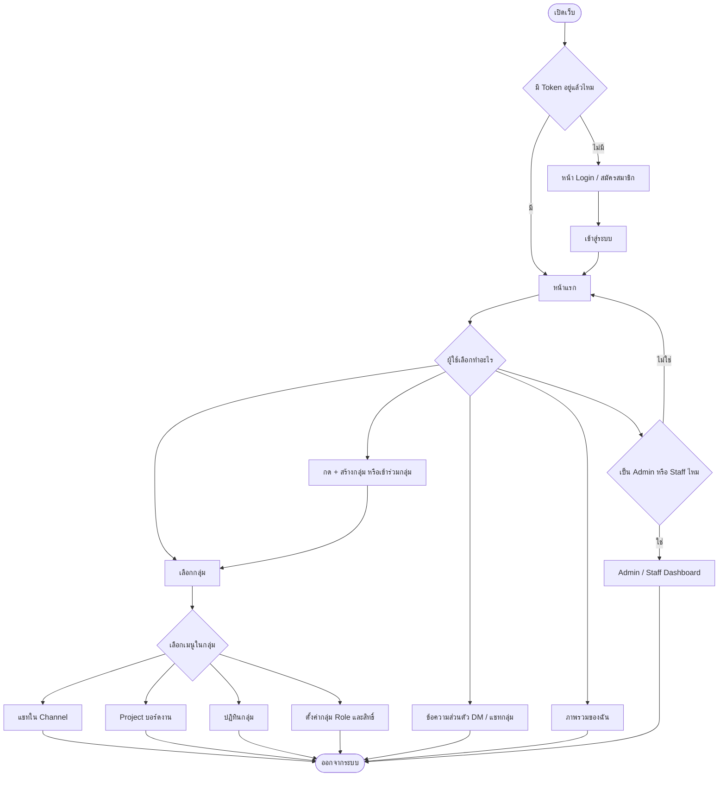
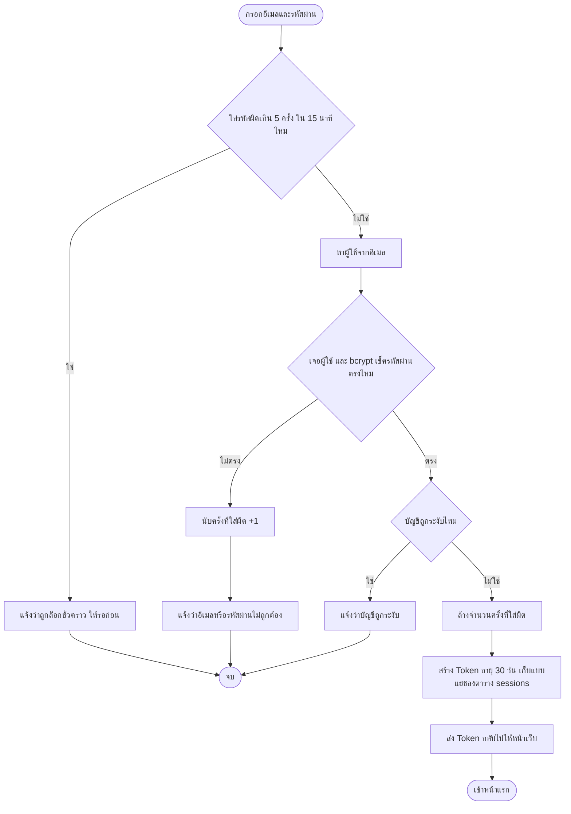
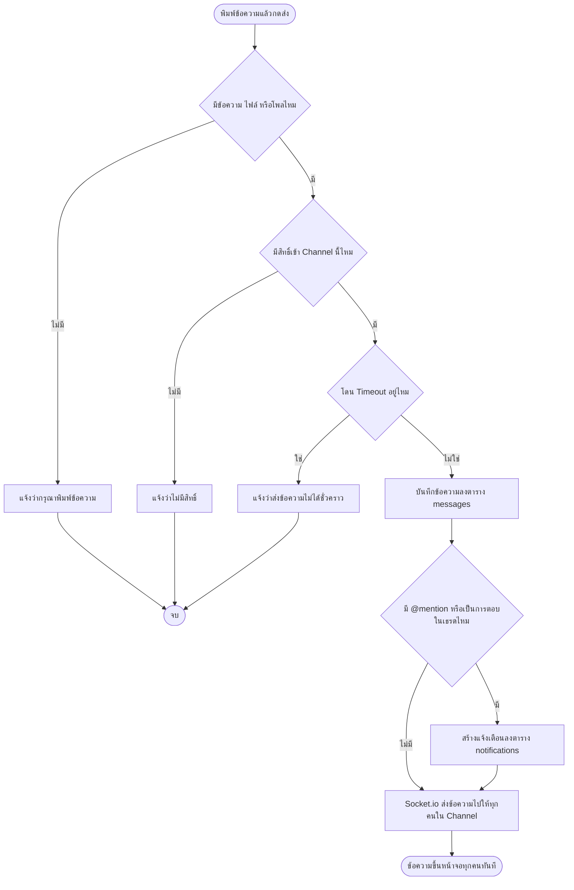
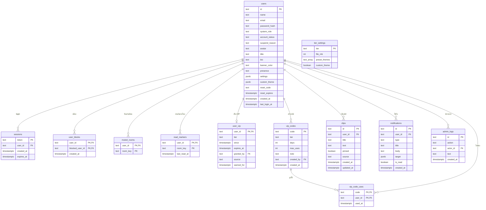
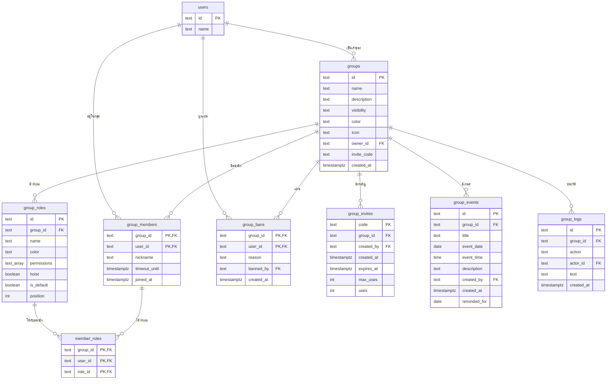
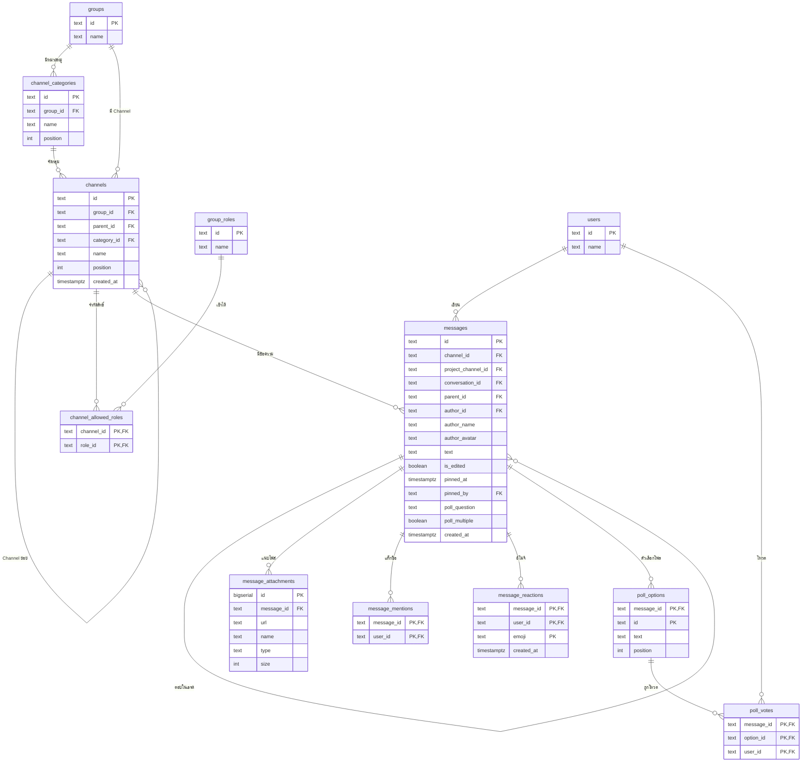
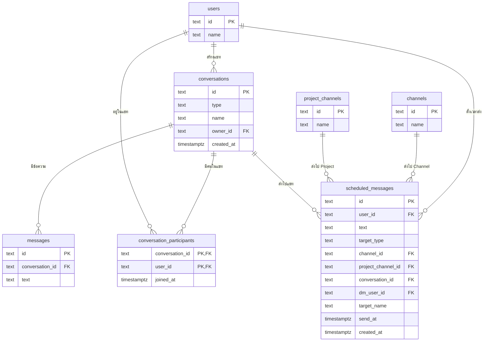
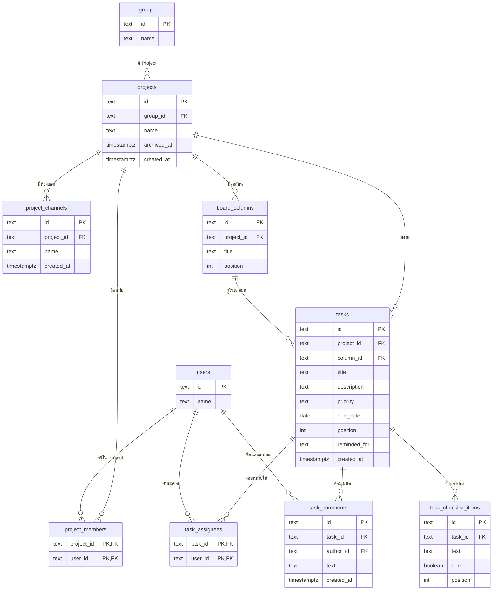

# Flowchart และ ER Diagram

---

## Flowchart

### 1. ภาพรวมการใช้งานระบบ

### 2. การเข้าสู่ระบบ (Login)

### 3. การส่งข้อความในแชท (เรียลไทม์)

---

## ER Diagram

ทั้งหมดมี 40 ตาราง แบ่งเป็น 5 ส่วนให้ดูง่าย

PK = Primary Key, FK = Foreign Key

### ส่วนที่ 1 ผู้ใช้ และ VIP

`tier_settings` ไม่ได้ต่อกับตารางไหน เป็นตารางตั้งค่าว่า VIP แต่ละระดับอัปโหลดไฟล์ได้กี่ MB และใช้ธีมอะไรได้

### ส่วนที่ 2 กลุ่ม Role และการดูแลกลุ่ม

### ส่วนที่ 3 Channel และข้อความ

ข้อความ 1 ข้อความจะอยู่ได้แค่ที่เดียว คือ Channel หรือ Channel ของ Project หรือแชทส่วนตัว (ต้องมีค่าใน `channel_id`, `project_channel_id`, `conversation_id` แค่ช่องเดียว)

### ส่วนที่ 4 แชทส่วนตัว และตั้งเวลาส่งข้อความ

### ส่วนที่ 5 Project และบอร์ดงาน

